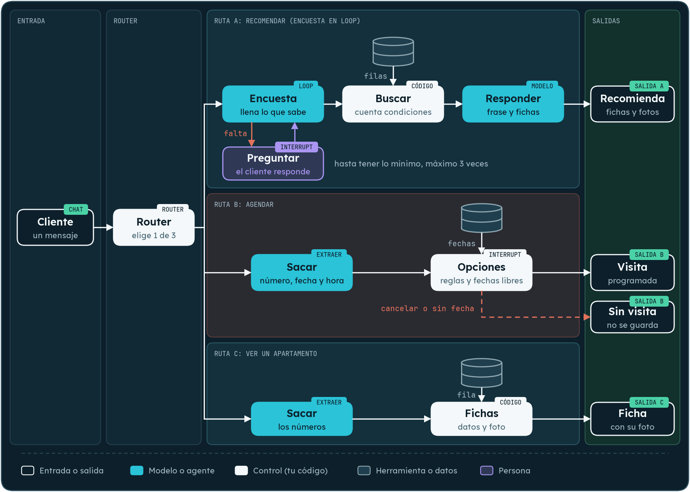
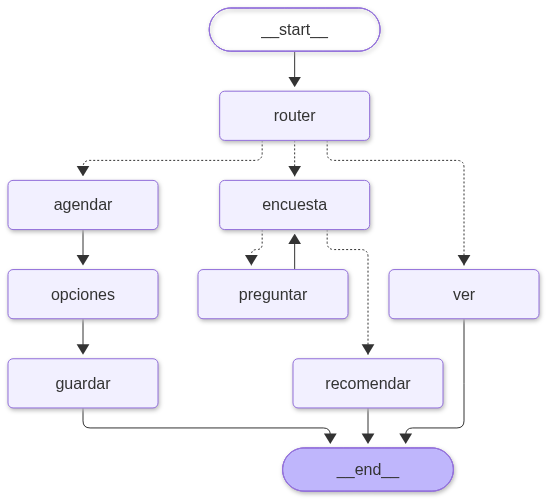

# Proyecto: el asistente de Señor Gato

Un chat para la **Inmobiliaria Señor Gato**. Sirve para:

- **Recomendar** un apartamento para comprar.
- **Agendar** o cancelar una visita.
- **Ver** un apartamento por su número (*muéstrame el 101*).



Así lo dibuja LangGraph a partir del grafo compilado:



## La base de datos

Es SQLite, que viene con Python. Tiene dos tablas: Recomendar lee `apartamentos` y Agendar guarda en `visitas`. Los datos están en `inmobiliaria.sql`.


## Cómo correrlo

Necesitan [uv](https://docs.astral.sh/uv/getting-started/installation/) y una clave de [Google AI Studio](https://aistudio.google.com/apikey).

1. Entrar a la carpeta e instalar las dependencias:

   ```bash
   cd proyecto_practica
   uv sync
   ```

2. Copiar `.env.example` como `.env` y poner la clave:

   ```bash
   cp .env.example .env
   ```

3. Revisar que todo esté listo. Las dos líneas deben decir OK:

   ```bash
   uv run python probar_conexion.py
   ```

4. Abrir el chat en http://localhost:8000:

   ```bash
   uv run chainlit run app.py -w
   ```

## Para probar

Los pasos están en [chainlit.md](chainlit.md).