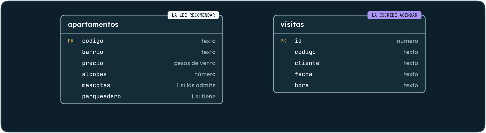

# Proyecto: el asistente de Señor Gato

Un chat de Chainlit para los clientes de la **Inmobiliaria Señor Gato**, una inmobiliaria ficticia de Medellín. Hace tres cosas:

- **Recomendar** apartamentos para comprar (solo venta, nada de arriendo): pregunta lo que el cliente busca y le ofrece el que más le sirve.
- **Agendar** visitas: muestra las reglas y las fechas libres, y el cliente confirma antes de guardar la visita. Al confirmar también puede ver otra fecha o cancelar.
- **Ver** un apartamento: con su número (*muéstrame el 101*), el chat muestra su ficha y su foto.


Así lo dibuja LangGraph a partir del grafo compilado:


Cuando el asistente recomienda, cada apartamento sale con su ficha (la arma el código: precio,
alcobas, mascotas y parqueadero) y su dibujo: la fachada y el plano. Los
dibujos están en `public/apartamentos/` y salen de `uv run herramientas/apartamentos.py`, desde la
raíz del repositorio. Las fechas que ofrece para visitar las calcula el código: cumplen las reglas
y no están ocupadas.

## La base de datos

Es SQLite, que viene con Python. Tiene dos tablas: Recomendar lee `apartamentos` y Agendar guarda en `visitas`. Los datos están en `inmobiliaria.sql`.



## Cómo correrlo

Necesitan [uv](https://docs.astral.sh/uv/getting-started/installation/) y una clave de [Google AI Studio](https://aistudio.google.com/apikey).

1. Entrar a la carpeta e instalar las dependencias:

   ```bash
   cd proyecto_practica
   uv sync
   ```

2. Copiar `.env.example` como `.env` y poner la clave:

   ```bash
   cp .env.example .env
   ```

3. Revisar que todo esté listo. Las dos líneas deben decir OK:

   ```bash
   uv run python probar_conexion.py
   ```

4. Abrir el chat en http://localhost:8000:

   ```bash
   uv run chainlit run app.py -w
   ```

## Para probar

Los pasos están en [chainlit.md](chainlit.md). El chat también los muestra en su botón de Readme.
